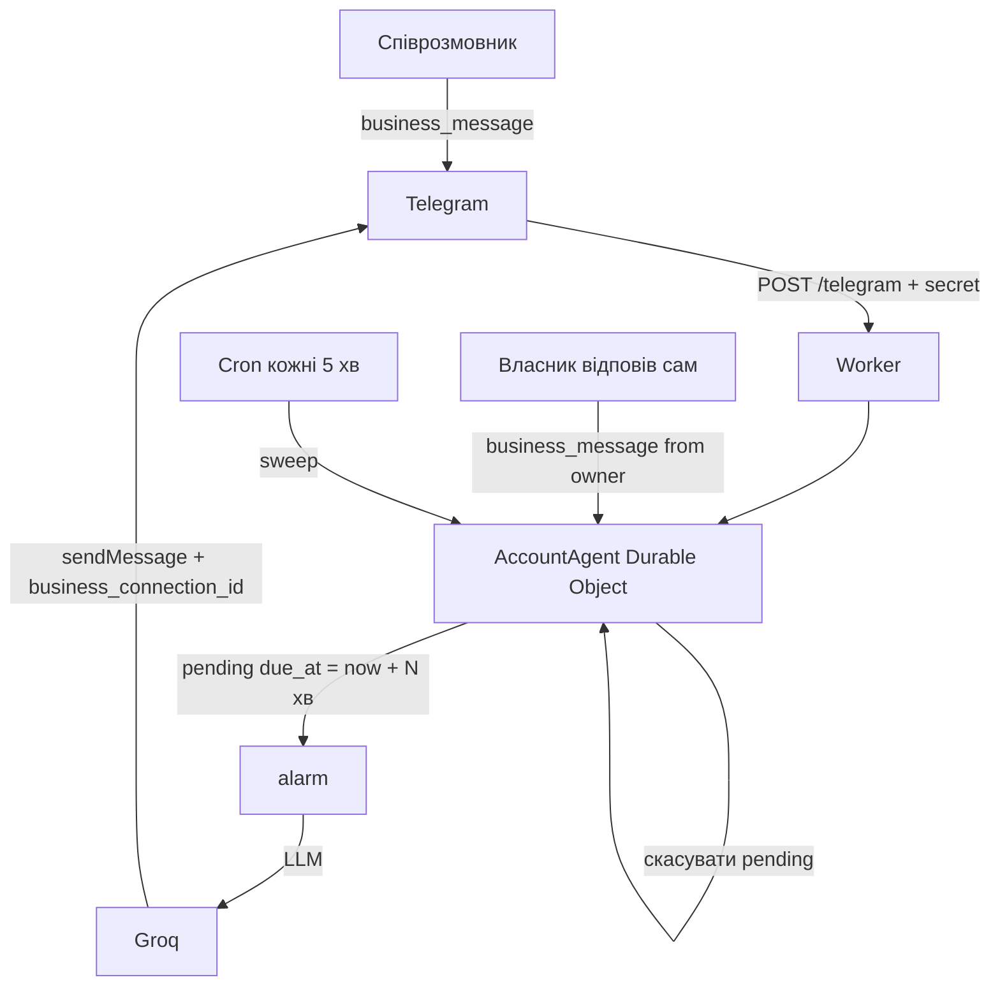

# Telegram AI-секретар

Бот, який підключається до акаунта Telegram через **Автоматизація чатів** і
відповідає від імені власника, якщо той сам не відповів протягом N хвилин
(за замовчуванням 5). Працює на безкоштовному плані Cloudflare Workers, без
картки, без VPS і без окремої бази даних.

- Telegram Bot API: `business_connection`, `business_message`, `sendMessage` з `business_connection_id`
- Стан і таймери: Durable Object з SQLite та `alarm`
- LLM: будь-який OpenAI-сумісний API, за замовчуванням Groq (`openai/gpt-oss-120b`)
- Персона: бот представляється **ШІ-помічником власника**, а не видає себе за нього

## Швидкий старт

Повна покрокова інструкція для людини або AI-агента — у [SETUP.md](SETUP.md).

```bash
npm install
cp .dev.vars.example .dev.vars   # заповніть 4 значення
npx wrangler login
npm run deploy
# після деплою: wrangler secret put ×4 і npm run webhook -- <url>/telegram
```

Далі в Telegram: **Налаштування → Автоматизація чатів → додати бота**, увімкнути
дозволи **Відповідати** і **Читати повідомлення**.

## Як це працює



1. Вхідне повідомлення зберігається в історію чату і ставить `pending` на `now + DELAY_MINUTES`.
2. Кожне наступне повідомлення від співрозмовника перезапускає таймер цього чату.
3. Якщо власник пише в цей чат сам — `pending` скасовується, бот мовчить.
4. Коли таймер спрацьовує, бот збирає останні 8 повідомлень, просить LLM відповідь і надсилає її від акаунта власника.
5. Раз на 5 хвилин cron добирає прострочені `pending` (страховка) і чистить історію старшу за `HISTORY_TTL_DAYS`.

Співрозмовник бачить повідомлення від акаунта власника, але бот у ньому
представляється його ШІ-помічником.

## Характер відповідей

Бот не вдає власника. Він представляється **ШІ-помічником** (ім'я власника
береться з `OWNER_NAME`), говорить про себе в чоловічому роді в українській і
російській і коротко каже, що власник зараз не може відповісти й відповість
найближчим часом. Формулювання щоразу різні: промпт забороняє повторювати ту
саму конструкцію, а температура моделі — 0.8.

| Що надіслали | Як відповідає |
| --- | --- |
| Робота, гроші, документи, дедлайни | спокійно і ввічливо, просить викласти суть |
| TikTok, Instagram Reels, YouTube Shorts, меми | одна фраза легкої іронії: «зараз займається кориснішими речами, ніж дивитися TikTok — вам теж раджу. А якщо є справа, пишіть» |
| Особисте, емоційне, конфлікт | коротко, тепло, без жартів |
| Незрозуміло | нейтральна утримуюча відповідь |

Посилання на короткі відео визначаються в коді ([src/prompt.ts](src/prompt.ts),
`isEntertainmentLink`), а не лише моделлю. «Друг» чи «не друг» технічно не
визначається — лише тип контенту.

Обмеження, яких бот дотримується: не вигадує факти про власника, не обіцяє
гроші, знижки чи зустрічі, не дає порад (крім легкої репліки про TikTok).

Доповнення можна додати без редеплою: `/prompt <текст>`, скинути — `/prompt reset`.

## Сповіщення власнику

У діловій розмові бот може запропонувати: «Якщо хочете, я можу йому передати».
Якщо співрозмовник погоджується або сам просить передати, бот відповідає, що
передав, і надсилає власнику в приват короткий зміст із посиланням на чат:

```
Марія (@maria_dev) просить передати:

Просить рахунок за жовтень до п'ятниці.

Відкрити чат: https://t.me/maria_dev
```

Тому сповіщення потрібно вмикати лише для чату з ботом — решта чатів може
лишатися беззвучною.

Технічно: модель додає службовий маркер `[NOTIFY] <суть>`. [src/notify.ts](src/notify.ts)
вирізає його перед відправкою співрозмовнику, а [src/agent.ts](src/agent.ts)
надсилає текст власнику через `sendMessage` у `user_chat_id` підключення.
Сповіщення надсилається лише тоді, коли останнє повідомлення співрозмовника
справді є згодою або проханням передати ([src/notify.ts](src/notify.ts),
`isForwardRequest`).

Прохання передати обробляються **негайно**, без очікування `DELAY_MINUTES`.

## Команди

Надсилаються боту в приват, приймаються лише з `OWNER_TELEGRAM_ID`:

| Команда | Дія |
| --- | --- |
| `/status` | стан підключення, затримка, скільки відповідей у черзі |
| `/delay 5` | відповідати через N хвилин (1–1440) |
| `/pause` | не відповідати ніде |
| `/resume` | знову відповідати |
| `/prompt <текст>` | додаткові інструкції для ШІ |
| `/prompt reset` | прибрати інструкції |
| `/forget` | стерти збережену історію |
| `/test-notify` | надіслати тестове сповіщення в чат із ботом |
| `/help` | список команд |

`/delay` діє для нових повідомлень; уже заплановані не переносяться.

## Налаштування

Змінні у [wrangler.jsonc](wrangler.jsonc):

| Змінна | За замовчуванням | Що робить |
| --- | --- | --- |
| `DELAY_MINUTES` | `5` | через скільки хвилин відповідати |
| `OWNER_NAME` | `Олексій` | ім'я власника в промпті; **змініть на своє** |
| `HISTORY_TTL_DAYS` | `7` | скільки днів зберігати історію |
| `LLM_BASE_URL` | Groq | будь-який OpenAI-сумісний endpoint |
| `LLM_MODEL` | `openai/gpt-oss-120b` | id моделі |
| `PRESENCE_ENABLED` | `false` | опційний режим присутності (див. нижче) |

Секрети (лише через `wrangler secret put`):

- `TELEGRAM_BOT_TOKEN`
- `TELEGRAM_WEBHOOK_SECRET`
- `GROQ_API_KEY`
- `OWNER_TELEGRAM_ID`

Секрети ніколи не потрапляють у репозиторій. Локальні значення для
`wrangler dev` живуть у `.dev.vars`, який у `.gitignore`.

## Локальна розробка

```bash
npm run dev
```

Перевірка, що webhook живий (спочатку реєструємо підключення, потім повідомлення):

```bash
set -a; . ./.dev.vars; set +a

curl -s -X POST http://127.0.0.1:8787/telegram \
  -H "X-Telegram-Bot-Api-Secret-Token: $TELEGRAM_WEBHOOK_SECRET" \
  -H 'content-type: application/json' \
  -d "{\"update_id\":1,\"business_connection\":{\"id\":\"test\",\"user\":{\"id\":$OWNER_TELEGRAM_ID,\"is_bot\":false},\"user_chat_id\":$OWNER_TELEGRAM_ID,\"date\":0,\"rights\":{\"can_reply\":true,\"can_read_messages\":true},\"is_enabled\":true}}"

curl -s -X POST http://127.0.0.1:8787/telegram \
  -H "X-Telegram-Bot-Api-Secret-Token: $TELEGRAM_WEBHOOK_SECRET" \
  -H 'content-type: application/json' \
  -d '{"update_id":2,"business_message":{"message_id":1,"date":0,"business_connection_id":"test","chat":{"id":222,"type":"private","first_name":"Test"},"from":{"id":222,"first_name":"Test"},"text":"привіт"}}'
```

Локально реального бота немає, тому `sendMessage` впаде з помилкою Telegram — це
очікувано. Наскрізний тест робіть після деплою з другого акаунта.

Логи продакшену: `npx wrangler tail --format pretty`.

## Обмеження Telegram

- Тільки **приватні чати**; групи й канали ігноруються.
- Бот може відповісти лише протягом **24 годин** від останнього вхідного повідомлення.
- На акаунт можна підключити **одного** бота.
- Права (`can_reply`, `can_read_messages`, …) видає власник; без `can_reply` бот лише читає.
- Співрозмовник не бачить позначки «бот», але бот сам представляється ШІ-помічником.

## Приватність

Переписка проходить через два сторонні сервіси:

- **Cloudflare** зберігає повідомлення в Durable Object до `HISTORY_TTL_DAYS` днів;
- **Groq** (або інший LLM) отримує останні 8 повідомлень чату для генерації відповіді.

Зменшити слід: `/forget`, `HISTORY_TTL_DAYS=1`, або локальна модель через
`LLM_BASE_URL`.

## Опційно: присутність замість таймера

У коді є експериментальний режим: замість фіксованої затримки бот може
відповідати через 15 секунд, коли власник не в мережі, і мовчати, коли він
онлайн. Для цього потрібен клієнт, який надсилає маячок на `POST /presence`.

За замовчуванням режим **вимкнений** (`PRESENCE_ENABLED=false`), endpoint
повертає 404, і поведінка повністю визначається таймером. Щоб увімкнути:

1. `PRESENCE_ENABLED=true` у `wrangler.jsonc`.
2. `npx wrangler secret put PRESENCE_TOKEN`.
3. Налаштувати маячок у клієнті: `POST /presence`, заголовок `X-Presence-Token`,
   тіло `{"state":"online"|"away","device":"phone"}`; `online` живе 90 секунд,
   далі стан стає `away`.

Це не входить у базове налаштування і для більшості випадків не потрібно.

## Структура

```
src/index.ts      роутер webhook, cron, /presence
src/agent.ts      Durable Object: стан чатів, таймери, alarm, команди
src/registry.ts   Durable Object: список підключень і присутність
src/db.ts         SQLite-схема
src/telegram.ts   типи Bot API і виклики методів
src/llm.ts        OpenAI-сумісний клієнт
src/prompt.ts     системний промпт і контекст
src/notify.ts     маркер [NOTIFY] і текст сповіщення
src/presence.ts   логіка присутності (опційно)
scripts/set-webhook.mjs
```

## Діагностика

| Симптом | Причина |
| --- | --- |
| Бот не отримує повідомлення | Secretary Mode не увімкнений у BotFather, або бота не додано в «Автоматизацію чатів» |
| `/status` пише «Бот ще не підключений» | Не прийшов `business_connection`; перевірте webhook (`--info`) |
| Бот бачить чат, але не відповідає | Немає права «Відповідати», стоїть `/pause`, або минуло 24 години |
| Відповідь не приходить | `wrangler tail`: 429 від Groq, невірний `OWNER_TELEGRAM_ID`, ліміти |
| `Unauthorized` у логах | `TELEGRAM_WEBHOOK_SECRET` не збігається з тим, що у `setWebhook` |
| Webhook 404 | URL має закінчуватися на `/telegram` |
| `503` на `/presence` | `PRESENCE_ENABLED=false` або не заданий токен |

## Як поділитися проєктом

Репозиторій можна зробити публічним: у ньому немає секретів, лише код і
інструкції. Кожен користувач створює власного бота, власний ключ Groq і власний
Cloudflare-акаунт.

Не публікуйте форк Android-клієнта з цієї ж теки: він містить `APP_ID`,
`APP_HASH` і налаштування конкретного застосунку. Для базового сценарію форк
клієнта не потрібен взагалі.
